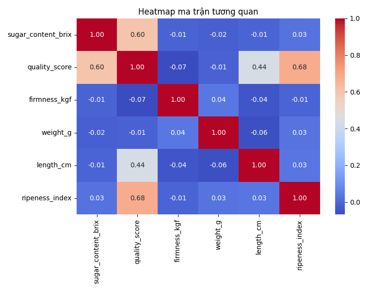
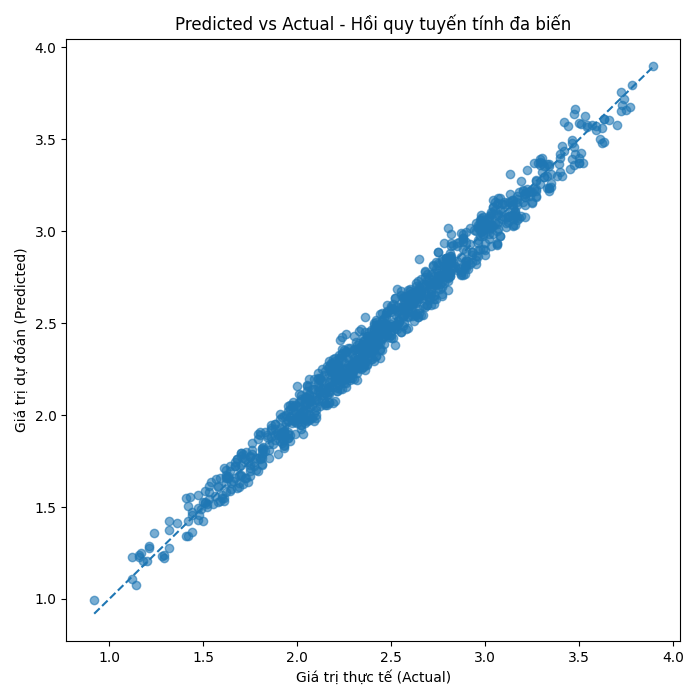

# Banana Quality Analysis 🍌

**Phân tích mối liên hệ giữa đặc trưng của chuối và điểm chất lượng bằng Python và hồi quy tuyến tính.**

Dự án bài tập lớn môn Kỹ thuật phân tích dữ liệu, được tổ chức thành quy trình có thể chạy lại: đọc dữ liệu → thống kê mô tả → trực quan hóa → tương quan → hồi quy → đánh giá train/test và đa cộng tuyến. Đây là dự án phân tích dữ liệu, **không phải ứng dụng AI triển khai production**.

## 1. Bài toán và dữ liệu

Mục tiêu là tìm hiểu mối liên hệ giữa **độ ngọt, độ cứng, chiều dài, khối lượng, độ chín** với `quality_score`. Mối liên hệ thống kê không tự chứng minh quan hệ nhân quả.

- Dữ liệu: `data/banana_quality_dataset.csv` (nguồn ban đầu: Kaggle – Banana Quality Dataset).
- Đầu vào: `sugar_content_brix`, `firmness_kgf`, `length_cm`, `weight_g`, `ripeness_index`.
- Biến mục tiêu: `quality_score`.
- Mã nguồn kiểm tra các cột bắt buộc, kiểu dữ liệu số, dữ liệu rỗng và giá trị thiếu ở những cột dùng cho mô hình.

## 2. Công nghệ

Python 3.11, pandas, NumPy, Matplotlib, seaborn, scikit-learn, statsmodels và pytest.

## 3. Cài đặt và chạy

```powershell
git clone https://github.com/VuHuuThinh05/banana-quality-analysis.git
cd banana-quality-analysis
python -m venv .venv
.\.venv\Scripts\Activate.ps1
python -m pip install -r requirements.txt
```

Chạy toàn bộ 7 bước:

```powershell
python run_pipeline.py
```

Trong một số môi trường, các biểu đồ có thể mở cửa sổ tương tác; đóng cửa sổ để script tiếp tục. Nếu chỉ muốn lưu ảnh mà không mở cửa sổ:

```powershell
$env:MPLBACKEND="Agg"
python run_pipeline.py
```

Chạy kiểm thử:

```powershell
python -m pytest -q
```

Có thể chạy riêng từng script, ví dụ `python src/07_vif_train_test.py`.

## 4. Các bước xử lý

| Script | Chức năng | Kết quả |
| --- | --- | --- |
| `01_load_data.py` | Đọc và kiểm tra dữ liệu | Thông tin dataset |
| `02_descriptive.py` | Thống kê mô tả | `output/csv/thong_ke_mo_ta.csv` |
| `03_visualization.py` | Histogram, scatter plot | Ảnh trong `output/png/` |
| `04_correlation.py` | Tương quan Pearson | CSV và heatmap |
| `05_regression_simple.py` | Hồi quy tuyến tính đơn | Phương trình và đồ thị |
| `06_regression_multivariate.py` | Hồi quy đa biến, hệ số | CSV, predicted vs actual, **R² in-sample** |
| `07_vif_train_test.py` | VIF có intercept, chia 80/20 | R², MAE, RMSE train/test; `vif.csv` |

Các script gốc được giữ để tiện đối chiếu bài tập lớn; `src/common.py` cung cấp hàm kiểm tra dữ liệu dùng chung và `run_pipeline.py` gọi tuần tự các script.

## 5. Kết quả và cách diễn giải

- Hồi quy đa biến trong báo cáo ban đầu có R² khoảng **0,98**; đây không phải “98% accuracy”.
- **Chỉ số đánh giá trên tập test** được in bởi `07_vif_train_test.py` với `test_size=0.2`, `random_state=42`. Cần chạy script để xác nhận số liệu cụ thể trên môi trường hiện tại.
- VIF giúp nhận diện đa cộng tuyến giữa các biến giải thích. Phiên bản cải tạo tính VIF với **intercept**, vì vậy giá trị có thể khác file CSV được lưu trước đó.
- Mô hình có thể phù hợp với bộ dữ liệu này nhưng chưa được xác minh trên nguồn dữ liệu độc lập.

### Minh chứng

**Tương quan giữa các biến**



**Giá trị dự đoán và giá trị thực tế (trên dữ liệu fit trong script 06)**



## 6. Cấu trúc thư mục

```text
banana-quality-analysis/
├── data/
│   └── banana_quality_dataset.csv
├── src/
│   ├── 01_load_data.py
│   ├── 02_descriptive.py
│   ├── 03_visualization.py
│   ├── 04_correlation.py
│   ├── 05_regression_simple.py
│   ├── 06_regression_multivariate.py
│   ├── 07_vif_train_test.py
│   └── common.py
├── tests/
│   ├── test_data.py
│   └── test_regression.py
├── output/
│   ├── csv/
│   └── png/
├── run_pipeline.py
├── requirements.txt
├── .gitignore
└── README.md
```

## 7. Giới hạn và hướng phát triển

- Hồi quy tuyến tính mô tả mối liên hệ, không xác lập quan hệ nhân quả.
- Các biểu đồ/hệ số ở script 05–06 dùng toàn bộ dữ liệu cho mục tiêu khám phá; **đánh giá khả năng tổng quát hóa phải dựa trên tập test** trong script 07.
- Chưa có kiểm chứng trên bộ dữ liệu độc lập; chưa đóng gói thành dịch vụ API.
- Các kiểm thử mới kiểm tra tính hợp lệ của dữ liệu và kết quả hồi quy cơ bản, chưa bao phủ toàn bộ biểu đồ và thao tác file.

Dự án ưu tiên tính dễ hiểu, tái lập và kiểm thử thay vì bổ sung mô hình phức tạp không cần thiết.
