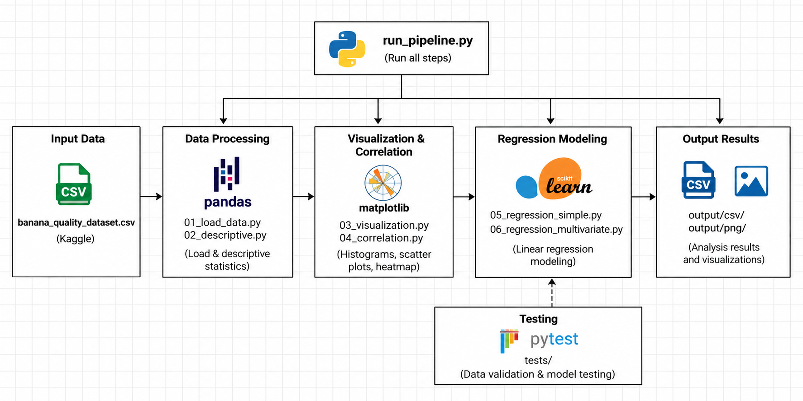

# Kiến trúc hệ thống – Banana Quality Analysis

## 1. Tổng quan

**Banana Quality Analysis** là dự án phân tích dữ liệu bằng Python nhằm tìm hiểu mối liên hệ giữa các đặc trưng của quả chuối và điểm chất lượng (`quality_score`). Dự án sử dụng thống kê mô tả, trực quan hóa, phân tích tương quan và hồi quy tuyến tính.

Hệ thống chạy **trên máy cá nhân**, xử lý dữ liệu từ tệp CSV và lưu kết quả dưới dạng bảng CSV, biểu đồ PNG. Đây không phải ứng dụng web hay dịch vụ dự đoán triển khai trực tuyến.

## 2. Sơ đồ kiến trúc



Sơ đồ thể hiện các nhóm chức năng chính và công cụ sử dụng. `run_pipeline.py` điều phối việc thực thi các script phân tích; `pytest` được chạy riêng để kiểm thử.

## 3. Luồng xử lý dữ liệu

```text
data/banana_quality_dataset.csv
              |
              v
       run_pipeline.py
              |
              v
     01_load_data.py            Đọc và kiểm tra dữ liệu
              |
              v
     02_descriptive.py          Thống kê mô tả
              |
              v
     03_visualization.py        Biểu đồ và dashboard
              |
              v
     04_correlation.py          Tương quan Pearson và heatmap
              |
              v
     05_regression_simple.py    Hồi quy tuyến tính đơn
              |
              v
     06_regression_multivariate.py
                                Hồi quy tuyến tính đa biến
              |
              v
     07_vif_train_test.py       VIF và đánh giá train/test
              |
              v
        output/csv/
        output/png/
```

**Lưu ý:** Các mũi tên mô tả **thứ tự chạy script**, không có nghĩa dữ liệu được truyền trực tiếp giữa các script qua một DataFrame chung. Các script đọc dữ liệu đầu vào khi cần.

## 4. Thành phần và công nghệ

| Thành phần | Chức năng | Công nghệ |
| --- | --- | --- |
| `data/banana_quality_dataset.csv` | Dữ liệu đầu vào | CSV |
| `run_pipeline.py` | Chạy tuần tự các bước phân tích | Python |
| `src/common.py` | Hàm dùng chung để đọc và kiểm tra dữ liệu | Python, pandas |
| `01_load_data.py`, `02_descriptive.py` | Khảo sát dữ liệu và thống kê mô tả | pandas |
| `03_visualization.py`, `04_correlation.py` | Vẽ biểu đồ, dashboard và phân tích tương quan | Matplotlib, seaborn, pandas |
| `05_regression_simple.py`, `06_regression_multivariate.py` | Xây dựng mô hình hồi quy tuyến tính | scikit-learn |
| `07_vif_train_test.py` | Kiểm tra đa cộng tuyến và đánh giá mô hình | statsmodels, scikit-learn |
| `tests/` | Kiểm thử dữ liệu và hành vi hồi quy cơ bản | pytest |
| `output/csv/`, `output/png/` | Lưu bảng thống kê, hệ số và biểu đồ | CSV, PNG |

Mô hình hồi quy đa biến sử dụng 5 đặc trưng: `sugar_content_brix`, `firmness_kgf`, `length_cm`, `weight_g`, `ripeness_index`. Biến mục tiêu là `quality_score`.

## 5. Chạy hệ thống

Tại thư mục gốc của dự án, sử dụng PowerShell:

```powershell
python -m pip install -r requirements.txt
$env:MPLBACKEND="Agg"
python run_pipeline.py
```

Kiểm thử được thực hiện độc lập:

```powershell
python -m pytest -q
```

Sau khi pipeline chạy, các bảng kết quả nằm trong `output/csv/` và hình ảnh nằm trong `output/png/`. Một số lệnh `plt.show()` có thể tạo cảnh báo khi dùng backend `Agg`, nhưng không ngăn việc lưu ảnh.

## 6. Đánh giá và giới hạn

Với cách chia dữ liệu **80% train / 20% test** và `random_state=42`, kết quả chạy cục bộ đã ghi nhận:

| Chỉ số | Tập kiểm thử |
| --- | ---: |
| R² | **0.9830** |
| MAE | **0.0606** |
| RMSE | **0.0716** |

Đây là các chỉ số **hồi quy**, không phải độ chính xác phân loại. VIF được tính với hệ số chặn và có giá trị gần 1, chưa cho thấy đa cộng tuyến đáng kể giữa năm đặc trưng trên tập dữ liệu này.

Dự án tập trung vào phân tích và đánh giá trên dataset hiện có; kết quả chưa được xác nhận trên một tập dữ liệu độc lập bên ngoài. Các mối liên hệ thống kê không tự chứng minh quan hệ nhân quả.
